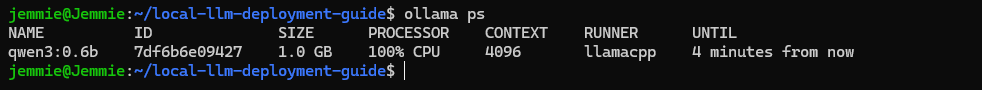
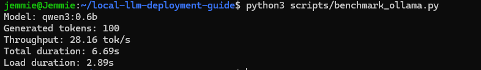

# Local LLM Deployment & Hardware Sizing

A reproducible DevOps study comparing Ollama, llama.cpp,
LM Studio, and vLLM for local AI inference.

## Scope

- Framework architecture and compatibility
- GGUF quantization and memory trade-offs
- Hardware sizing across 3B–32B models
- CPU deployment on Windows 11 / WSL2
- 24 GB NVIDIA GPU deployment procedures
- Inference benchmarking and automated validation

## Architecture

Client → Local API → Inference Runtime → CPU/GPU

## Validated CPU Benchmark

| Metric | Result |
|---|---|
| Model | Qwen3 0.6B |
| Runtime | Ollama 0.40.15 |
| Processor | CPU |
| Generated tokens | 100 |
| Throughput | 28.16 tok/s |
| Total duration | 6.69 s |
| Model load time | 2.89 s |

Results represent one measured inference run.

## Documentation

| Resource | Description |
|---|---|
| [Framework Comparison](docs/research/framework-comparison.md) | Runtime evaluation |
| [Quantization](docs/research/quantization.md) | GGUF precision trade-offs |
| [Hardware Sizing](docs/research/hardware-sizing.md) | Model memory estimates |
| [Laptop Guide](docs/guides/laptop-setup.md) | Validated CPU deployment |
| [24 GB GPU Guide](docs/guides/gpu-24gb-setup.md) | GPU deployment procedures |
| [Benchmark Results](benchmarks/results-summary.md) | Measured CPU performance |
| [Throughput Estimates](docs/research/throughput-estimates.md) | Analytical RTX 4090 performance scenarios |
| [GPU Validation](docs/research/gpu-validation.md) | Hardware findings and limitations |
| [References](docs/research/references.md) | Technical sources |

## Reproduce

Generate the hardware sizing matrix:

    python3 scripts/hardware_sizing.py

Run automated tests:

    python3 -m unittest discover -s tests -v

Benchmark a running Ollama instance:

    python3 scripts/benchmark_ollama.py

## Validation

- CPU model deployment: PASS
- Local inference API: PASS
- CPU benchmark: PASS
- Automated tests: 12 passed
- GPU hardware detection: Completed (Intel Iris Xe)
- NVIDIA CUDA GPU: Not available locally
- 24 GB GPU deployment: Documented, not tested
- GPU throughput: Analytical estimates only

## Limitations

Hardware sizing values are planning estimates,
not guaranteed minimum memory requirements.

Expected throughput depends on hardware, model,
quantization, context length, and concurrency.

GPU performance remains unverified without
access to compatible hardware.

## Security

Inference APIs should remain localhost-bound
unless access controls are implemented.

Model licenses, credentials, and sensitive data
must be reviewed before deployment.

## Validation Evidence

### CPU Inference — Ollama

### CPU Benchmark — Qwen3 0.6B

GPU inference remains untested because compatible NVIDIA hardware is unavailable.
